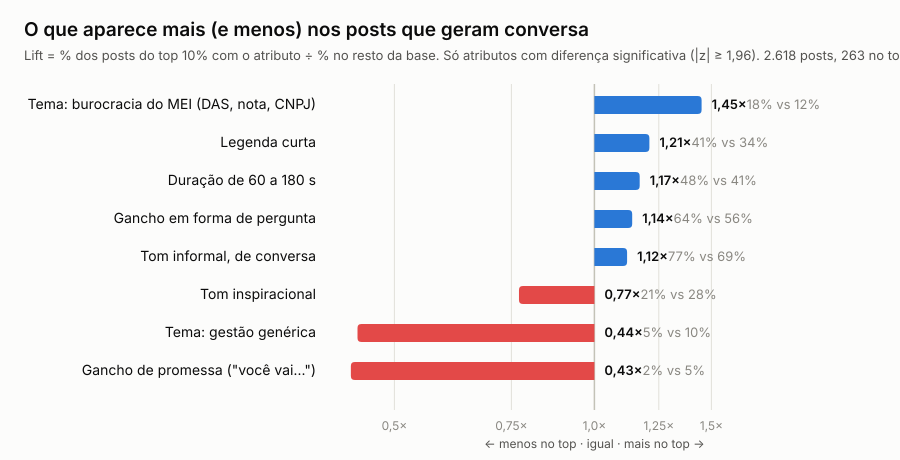
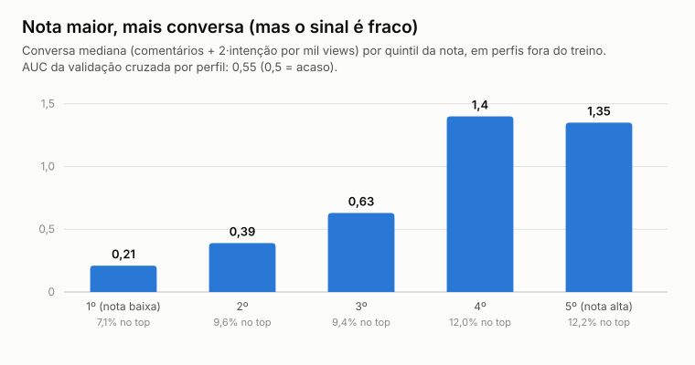

# Case Stone · Conversa, não curtida

Um avaliador e um agente de criativos para micro e pequenos empreendedores (MPEs), feitos para o Impulso Stone.
O projeto mede **engajamento qualificado** (comentários, perguntas e pedidos) e **não** alcance, views ou curtidas.

**Link do vídeo demo: https://youtu.be/hALAh2AtZXM**

> Case individual · Inteli Academy × Stone · entrega presencial em 25/11/2026

---

## 1. A tese: reação não é ação

O histórico de Meta Ads do próprio Impulso (fev–out/2026) mostra o problema:

| Criativo | Engajamento | CTR | Leitura |
|---|---:|---:|---|
| Depoimento Cristina | 3.255 | 0,82% | muita reação, quase nenhum clique |
| "POV: você decidiu empreender" | 900 | 0,97% | reação sem próximo passo |
| "Empreendedor(a), queremos..." | 18.851 | 8,82% | convite à participação |
| "Vendeu? E agora?" | 7.725 | 6,03% | dor real do pós-venda |

Um ranking por curtidas premiaria o depoimento. Este projeto premia o que leva a pessoa a **comentar, perguntar, pedir o link e participar**.

Na base, **só 7,4% do top 10% por conversa também está no top 10% por ER** (correlação de Spearman 0,28): as duas métricas escolhem posts diferentes.

## 2. A métrica

```
conversa = (comentários + 2 · comentários com intenção) ÷ views × 1000
```

*De cada mil pessoas que viram, quantas comentaram ou pediram algo.* Curtidas não entram. Views só entram como denominador, nunca como mérito.

- **Comentários com intenção** saem de um classificador por regras (`stone.intent`): *contato* ("quero", "qual o link"), *participação* ("como participo") e *dúvida* prática ("funciona pra MEI?"). Elogio genérico e emoji não contam.
- **Alto desempenho** = top 10% de conversa **dentro da faixa do perfil** (micro / médio / grande), só posts com 300+ views e 14+ dias, no máximo 15 posts por perfil.
- **Sensibilidade:** com peso 1 ou 4 para a intenção (em vez de 2), o top 10% continua 87% / 78% igual (Jaccard).
- **ER = (curtidas + comentários) ÷ seguidores**, recomendada no TAPI, é calculada e reportada lado a lado (`data/qualidade.md`).

## 3. A base

| | |
|---|---|
| Fonte | YouTube Data API v3 (rota oficial, sem scraping, TAPI 4.3) |
| Perfis | 52 canais do nicho MPE coletados, 44 ativos na base (15 micro, 15 médios, 15 grandes, menos 1 inativo) |
| Posts | 3.548 Shorts com 14+ dias · 2.618 rankeáveis (300+ views) · 263 no top 10% |
| Comentários | 11.093 lidos para estimar a taxa de intenção |
| Rubrica | 3.548 / 3.548 posts categorizados por Qwen3-VL 8B local (thumbnail + título + descrição) |

Relatório completo: [`data/qualidade.md`](data/qualidade.md). O Instagram ficou fora da base: a Graph API (Business Discovery) exige uma conta profissional ligada a uma Página do Facebook. O coletor está pronto (`stone.collect.instagram_bd`), mas a base do YouTube já demonstra o método.

## 4. Como funciona

```
COLETA (YouTube API) ─► BASE (SQLite + parquet) ─► MÉTRICA conversa / top 10%
        │                                                   │
        └──► comentários ─► intenção (regras)               ▼
                                         RUBRICA (Qwen3-VL, JSON com schema)
                                                            │
                                     PADRÕES (lift + z) ◄───┘
                                                            │
                                     AVALIADOR DE ADERÊNCIA (nota 0–100)
                                                            │
                  AGENTE LangGraph: entender → padrões → referências → gerar → avaliar
                                                            └─(nota < 60, até 3×)─► revisar
                                                            │
                         servidor MCP (FastMCP) · API local · demo web (máquina Stone)
```

1. **Rubrica** (`stone.rubric`, `stone.categorizar`): o VLM preenche formato, tipo de gancho, tema, pilar do Impulso, tom, CTA, prova social e notas de força do gancho e clareza. A saída é presa a um JSON Schema, com temperatura 0 e cache por conteúdo. Campos calculáveis (duração, tamanho da legenda) vêm do código, não do modelo.
2. **Padrões** (`stone.patterns`): lift de cada atributo = % no top 10% ÷ % no resto. Um padrão exige lift ≥ 1,25, 8+ posts e z ≥ 1,96; um antipadrão, lift ≤ 0,8 e z ≤ −1,96.
3. **Avaliador** (`stone.evaluator`): **não é um modelo preditivo** (TAPI 4.3 deixa isso fora do escopo). Ele mede **aderência** (TAPI 4.2): peso de cada atributo = log(lift), encolhido para zero quando há poucos posts. A nota é o percentil da soma dos pesos contra a base. Ausências (sem gancho, sem CTA, legenda vazia) nunca somam ponto. Devolve padrões cumpridos, antipadrões, até 5 sugestões "de → para" e 3 posts reais parecidos.
4. **Agente** (`stone.agente`): escreve posts do Impulso Stone para empreendedores de um segmento (o mesmo público da base). O grafo LangGraph:
   - classifica o segmento e extrai o **problema central** do pedido, que vira o assunto obrigatório do post;
   - busca padrões e referências e escreve o criativo, com cada cena separada em imagem e fala;
   - passa cada versão pelo avaliador e por uma checagem de texto (cenas repetidas, título copiado, legenda longa, roteiro sem falas, Impulso descrito como app);
   - reescreve se a nota ficar abaixo de 60 ou o texto tiver problema grave, até 3 versões.

   Duas travas vieram das evals (seção 6). **Tema e pilar não entram como "padrão a seguir"**: senão o agente trocava o problema do pedido pelo tema que mais pontua. **A duração é calculada pelas falas**, a ~2,5 palavras/s: o modelo declarava 120 s em tudo, e só a faixa de duração mudava a nota de 25 para 68.

   Entrega título, gancho, roteiro por cenas, texto de capa, legenda, CTA, justificativa e aviso de confiança. As mesmas ferramentas ficam expostas por MCP (`stone.agente.servidor_mcp`). Tudo é registrado em JSONL (`data/logs/`).
5. **Demo** (`web/`): Next.js com uma maquininha Stone desenhada em glifos. Digite um rascunho ou escolha um post real, aperte ENTRA, e sai o extrato com a nota e as sugestões.

## 5. Resultados

### O que aparece mais nos posts que geram conversa



Posts que geram conversa falam de **burocracia do MEI** (DAS, nota fiscal, CNPJ), abrem com uma **pergunta**, têm **tom de conversa** e legenda curta. Tom **inspiracional**, gancho de **promessa** e **gestão genérica** aparecem menos. São associações, não causas.

### O avaliador separa, mas pouco



Na validação cruzada agrupada por perfil (pesos aprendidos em uns canais e testados em outros), a **AUC é 0,55** (0,5 = acaso). Mesmo assim, a conversa mediana sobe **6×** do quintil de nota mais baixo (0,21) para os dois mais altos (1,35–1,4). O sinal existe, mas é fraco: a nota serve para revisar um rascunho, não para prever resultado.

### Checagem externa nos criativos do Impulso

Os 16 criativos do histórico de Meta Ads (10 melhores e 6 piores por CTR) passaram pela mesma rubrica, **pela imagem** extraída do PowerPoint, sem o comentário de desempenho do relatório. Os pesos vêm só da base do YouTube.

| Grupo | Criativos | Nota média | Nota mediana |
|---|---:|---:|---:|
| Melhores por volume (anúncios estáticos, CTR 2–3%) | 5 | 62 | 73 |
| Melhores por engajamento (posts, CTR 3,6–8,8%) | 5 | 42 | 47 |
| Piores (CTR 0,8–1,3%) | 6 | 31 | 27 |

- **AUC melhores vs piores = 0,75** (permutação exata, p ≈ 0,055 unilateral). Com 16 criativos, isso é um indício, não uma prova.
- **Acerta os casos de "reação sem ação":** o depoimento da Cristina (11), o "POV: você decidiu empreender" (9) e o "Para muitos empreendedores..." (9) ficam entre as notas mais baixas.
- **Não ordena dentro dos grupos:** a correlação de Spearman com o CTR é só 0,18. O criativo de maior CTR ("Empreendedor(a), queremos...", 8,82%) tirou 25, e dois motivacionais dos piores tiraram 57 e 59.

Leitura: os padrões do nicho no YouTube **transferem em parte** para o público do Impulso. A nota ajuda a descartar o pior, mas não escolhe o vencedor. Detalhe por criativo: [`data/impulso/checagem_avaliador.csv`](data/impulso/checagem_avaliador.csv).

## 6. Qualidade do agente (evals)

A nota de aderência diz se um texto se parece com o que gera conversa na base. Ela não diz se o criativo **responde ao pedido, acerta os fatos e é bem escrito**. Para medir isso, o agente passou por uma suíte do [DeepEval](https://deepeval.com) ([`tests/evals/`](tests/evals/README.md)):

- **18 pedidos:** os 6 reais (playbook + demo) e 12 variações geradas pelo deepeval, com casos difíceis.
- **Juiz independente:** o Claude Sonnet 5.5 rodando pelo Claude Code, mais forte que o Qwen 8B que escreve. Assim o modelo não corrige a própria prova.
- **4 critérios GEval**, cada um com seu limite de aprovação: fidelidade ao pedido, correção factual, engajamento qualificado e execução do roteiro.

| Rodada | O que mudou | Fidelidade | Fatos | Engajamento | Execução | Nota interna × juiz |
|---|---|---:|---:|---:|---:|---:|
| 1 · base | agente como estava | 0,40 (3/18) | 0,46 (5/18) | 0,51 (9/18) | 0,23 (0/18) | 0,12 |
| 2 · assunto | problema central do pedido, tema fora dos "padrões a seguir", duração pelas falas, cena = imagem + fala | 0,60 (9/18) | 0,39 (4/18) | 0,49 (5/18) | 0,32 (0/18) | −0,08 |
| 3 · fatos | sem contas nem porcentagens, Impulso como app vira problema grave, fato do DAS reforçado, fala duplicada limpa | 0,60 (8/18) | 0,55 (10/18) | 0,50 (6/18) | 0,34 (0/18) | −0,14 |

Média de 0 a 1 do juiz; entre parênteses, quantos pedidos passaram do limite. A última coluna é a correlação de Spearman entre a nota interna e a média do juiz.

O que as evals mostraram:

- **O agente fugia do pedido para o tema que mais pontua.** Com o resto igual, só trocar o tema leva a nota mediana de 30 (gestão) para 70 (burocracia do MEI). O prompt ainda listava "tema: burocracia MEI" como padrão a seguir. Assim, a lavanderia que queria atender prédios virou um post sobre nota do MEI, e a loja sem vendas virou um post sobre precificação. Tirar o tema dos padrões e fixar o problema do pedido subiu a fidelidade de 0,40 para 0,60.
- **A duração declarada comprava nota.** Só a faixa de duração leva a nota de 25 (15–30 s) para 68 (60–180 s), e o modelo declarava 120 s em tudo. Agora a duração sai das falas.
- **O prompt mandava seguir "ausências".** A lista de padrões incluía "sem CTA", "sem gancho" e "gancho fraco". O avaliador já não dava crédito a elas, mas o prompt do agente sim. Isso foi corrigido em `ferramentas.padroes`.
- **Fatos são o ponto fraco do 8B.** Ele descreve o DAS como cobrança por venda, inventa uma taxa para emitir nota e apresenta o Impulso como app, com telas e botões. Na rodada 2, pedir "um exemplo ou uma conta" piorou os fatos, porque o 8B erra a conta. A rodada 3 proíbe contas e trata "Impulso como app" como problema grave: os fatos foram de 0,39 para 0,55 (10 de 18 aprovados, contra 5 na base).
- **Execução continua o gargalo** (0,34, nenhum aprovado): o 8B repete ideias entre cenas e promete o que não entrega. Com o 8B, isso pede revisão humana ou um modelo maior.
- **A nota interna não mede a qualidade do criativo** (Spearman perto de zero nas três rodadas). Ela continua útil para o que foi feita, comparar um rascunho com os padrões do nicho, mas não serve para escolher entre versões geradas. Por isso o agente também usa a checagem de texto, e o fluxo certo continua sendo agente → revisão humana → post.

## 7. Limitações

- **Base só do YouTube.** O público e o formato do Instagram podem ser diferentes. A checagem com os criativos do Impulso é a ponte, e é pequena (16 criativos).
- **A rubrica vê a thumbnail e o texto, não o vídeo.** Ritmo de cortes, fala dos 3 primeiros segundos e áudio ficam de fora (o nível 2 previa frames e transcrição).
- **Sinal fraco** (AUC 0,55): a maior parte do que faz um post gerar conversa não está nos atributos medidos (canal, timing, assunto do dia).
- **Intenção por regras.** O classificador é explicável, mas não entende ironia nem contexto.
- **Seguidores da data da coleta**, não da data do post.
- **Segmentos pequenos.** Beleza tem só 1 post no top 10%: o agente usa os padrões da base inteira e avisa que a confiança é baixa.
- **Público dos criativos.** A base é de conteúdo feito para empreendedores, então o agente escreve posts do Impulso para empreendedores. Um post de um negócio para os próprios clientes (ex.: a confeitaria vendendo bolo) fica fora do que a base mede.
- **Modelo local de 8B.** O texto dos criativos é funcional, mas básico, e erra fatos e contas (seção 6). O mesmo grafo roda com um modelo maior trocando `stone.llm`.
- **Evals com um juiz e 18 pedidos.** O juiz é um único modelo (Sonnet 5.5), sem calibração contra notas humanas, e cada pedido roda uma vez. Diferenças pequenas entre rodadas podem ser ruído.

## 8. Como rodar

Pré-requisitos: Python 3.11, Node 20+, [Ollama](https://ollama.com) com `qwen3-vl:8b-instruct`. Para as evals, o [Claude Code](https://claude.com/claude-code) logado (o juiz roda por `claude -p`).

```powershell
python -m venv .venv; .venv\Scripts\pip install -r requirements.txt
copy .env.example .env          # YOUTUBE_API_KEY, só para coletar de novo
$env:PYTHONPATH = "src"

# base e análise (a base já está em data/; os comandos refazem cada etapa)
.venv\Scripts\python -m stone.collect.youtube --seeds data/seeds/perfis.csv
.venv\Scripts\python -m stone.base            # métricas + data/qualidade.md
.venv\Scripts\python -m stone.categorizar --todos   # rubrica (retomável, ~18 s/post na GPU)
.venv\Scripts\python -m stone.patterns        # data/padroes.md
.venv\Scripts\python -m stone.evaluator validar     # data/avaliador_validacao.md
.venv\Scripts\python -m stone.evaluator impulso     # data/impulso/checagem_avaliador.csv
.venv\Scripts\python -m stone.graficos        # playbook/graficos/*.svg

# agente
.venv\Scripts\python -m stone.agente.grafo "Post do Impulso para confeiteiras que vendem bolo por encomenda"
.venv\Scripts\python -m stone.playbook        # os 5 criativos do playbook
.venv\Scripts\python -m stone.agente.servidor_mcp   # MCP por stdio

# evals do agente (~30 min de GPU + juiz Claude)
.venv\Scripts\deepeval test run tests/evals/test_agente.py --identifier minha-rodada -i
.venv\Scripts\python tests/evals/relatorio.py minha-rodada

# demo
.venv\Scripts\python -m stone.api             # http://127.0.0.1:8765
cd web; npm install; npx next dev -p 3100     # http://localhost:3100
```

Sem a API no ar, a demo cai no modo de demonstração: posts reais já avaliados e uma execução gravada do agente.

Testes: `.venv\Scripts\python -m pytest` (73 testes, sem GPU). As evals do agente ficam à parte, com GPU e juiz: ver [`tests/evals/README.md`](tests/evals/README.md).

## 9. Estrutura

```
src/stone/
  collect/       coletores (YouTube, Instagram BD) com cache e backoff
  metrics.py     conversa, ER, EQ, top 10%
  intent.py      intenção nos comentários
  rubric.py      schema da rubrica · categorizar.py aplica em lote
  patterns.py    lift e padrões · evaluator.py nota de aderência
  agente/        grafo LangGraph, ferramentas, servidor MCP
  api.py         API local da demo · exportar_web.py dados estáticos da demo
  playbook.py    criativos de exemplo · graficos.py gráficos SVG
data/            base, relatórios, logs, materiais do Impulso
playbook/        playbook.md, criativos/, graficos/
web/             demo Next.js
tests/           testes (pytest) · tests/evals/ evals do agente (deepeval + juiz Claude)
```

## 10. Evolução

1. Instagram pela Graph API com a conta profissional do Impulso: rodar a mesma rubrica no público real.
2. Insights da Stone (salvamentos, compartilhamentos, cliques) como alvo, no lugar da estimativa por comentários.
3. Nível 2 da rubrica: frames e transcrição dos 3 primeiros segundos.
4. Intenção com modelo treinado nos comentários rotulados, no lugar das regras.
5. Fechar o ciclo: publicar criativos do agente e medir a conversa real contra a nota.
6. Usar o juiz das evals dentro do agente: um revisor de fatos e de fidelidade decide a versão entregue, no lugar da nota de aderência. Calibrar o juiz com algumas notas humanas antes.
