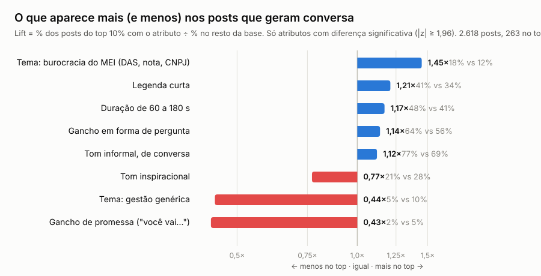

# Playbook · Posts que geram conversa

Para quem faz conteúdo para micro e pequenos empreendedores, no Impulso Stone ou no próprio negócio.
O objetivo aqui **não** é viralizar nem juntar curtidas. É fazer a pessoa **comentar, perguntar ou pedir algo**.

> De onde vem: 3.548 Shorts de 44 canais do nicho MPE, cada um categorizado por IA com a mesma rubrica. Alto desempenho = top 10% de **conversa** (comentários + 2 · comentários com intenção, por mil views) dentro da faixa do perfil. Os padrões são **associações**, não garantias. Metodologia completa no [README](../README.md).

---

## 1. Reação não é ação

A lição mais clara vem do próprio histórico do Impulso (Meta Ads, fev–out/2026):

| O que aconteceu | Exemplo | Engajamento | CTR |
|---|---|---:|---:|
| Muita reação, quase nenhum clique | Depoimento Cristina | 3.255 | 0,82% |
| Frase motivacional, sem próximo passo | "Vender mais não é sorte" | 766 | 0,77% |
| POV sem chamada | "POV: você decidiu empreender" | 900 | 0,97% |
| **Convite para participar** | **"Empreendedor(a), queremos..."** | **18.851** | **8,82%** |
| **Nicho e identificação** | **Post Segmentação Beleza** | **10.877** | **8,62%** |
| **Dor real, com pergunta** | **"Vendeu? E agora?"** | **7.725** | **6,03%** |

O que funciona **pede uma resposta**: convida, chama pelo nicho ou pergunta por uma dor concreta. O que falha **só pede um like**.

Na base do YouTube vale o mesmo: só 7,4% dos posts do top 10% por conversa também estão no top 10% por curtidas e comentários sobre seguidores (ER).

## 2. O que fazer

| Faça | Por quê | No top 10% | No resto |
|---|---|---:|---:|
| **Fale da burocracia que dói** (DAS, nota fiscal, CNPJ, limite do MEI) | é o assunto que mais gera dúvida nos comentários | 18% | 12% |
| **Abra com uma pergunta** ("Você sabe quanto cobrar por esse bolo?") | quem se reconhece responde | 64% | 56% |
| **Fale como conversa**, não como palestra | tom informal aparece mais no top | 77% | 69% |
| **Legenda curta**: o vídeo explica, a legenda pede a ação | legenda longa dilui o pedido | 41% | 34% |
| **Dê tempo para explicar** (60 a 180 s) quando o assunto é prático | tutoriais e explicações completas puxam dúvidas | 48% | 41% |

## 3. O que evitar

| Evite | No top 10% | No resto |
|---|---:|---:|
| **Gancho de promessa** ("você vai faturar o dobro") | 2% | 5% |
| **Gestão genérica**, sem um problema concreto | 5% | 10% |
| **Tom inspiracional** ("acredite no seu sonho") | 21% | 28% |

Os três somem do topo pelo mesmo motivo: são frases com as quais todo mundo concorda e ninguém precisa responder.

## 4. Por segmento

Os padrões mudam de segmento para segmento. Onde o segmento tem poucos posts no top, o agente usa os padrões da base inteira e avisa.

| Segmento | Posts no top 10% | Confiança | O que se destaca no segmento |
|---|---:|---|---|
| Alimentação | 54 | alta | finanças do negócio de comida (preço, lucro, custo) e prova social; legenda curta. Ex.: [RECEITA NÃO É EMPREENDER](https://www.youtube.com/shorts/6TMsMRsfzTE), 99,6 por mil |
| Varejo e vendas | 45 | alta | tutorial de marketing e vendas, tom informal, comunidade; evitar vídeos de até 15 s. Ex.: [Como ganhar dinheiro com a Shopee](https://www.youtube.com/shorts/ea01v_tH1JY), 35,6 por mil |
| MEI e contabilidade | 66 | alta | rosto falando para a câmera, alerta direto ("Muito CUIDADO, MEI"); evitar humor. Ex.: [Muito CUIDADO Microempreendedor](https://www.youtube.com/shorts/Vpu-A9oycyQ), 34,7 por mil |
| Pagamentos | 26 | média | gancho de pergunta sobre a maquininha, tutorial, oferta explícita. Ex.: [INFINITEPAY DERRUBOU O PREÇO](https://www.youtube.com/shorts/fI3YBIfgIHw), 39,1 por mil |
| Gestão e finanças | 60 | alta | finanças práticas e burocracia do MEI; evitar o tema "vendas" genérico. Ex.: [4 CURSOS GRÁTIS pra começar](https://www.youtube.com/shorts/GG4yYezMW1Q), 68,2 por mil |
| Artesanato e festas | 11 | baixa | bastidores do processo e linguagem regional (padrões da base inteira). Ex.: [Bolo Cenográfico na Prática](https://www.youtube.com/shorts/-vSC95MxcgQ), 15,7 por mil |
| Beleza | 1 | baixa | quase sem base: usar os padrões gerais e testar |
| Serviços locais | — | baixa | sem recorte na base (lavanderia, oficina, pet shop): padrões gerais |

## 5. Criativos de exemplo

Posts do Impulso Stone falando com empreendedores de um segmento, como o "Post Segmentação Beleza" (CTR 8,62%). É o mesmo público da base, então a nota vale para eles. Gerados pelo agente (LangGraph + Qwen3-VL 8B local), na versão corrigida pelas evals de 24/11. Cada versão passa pelo avaliador e por uma checagem de texto (cenas repetidas, título copiado na capa ou na legenda, legenda longa, roteiro sem falas, Impulso descrito como app). A coluna do juiz vem das evals (Claude Sonnet 5.5, de 0 a 1). O agente reescreve quando a nota fica abaixo de 60 ou o texto tem problema, até 3 versões. Os arquivos completos trazem roteiro, legenda, CTA, justificativa e as referências reais usadas.

> Os textos saem de um modelo local de 8B: são rascunhos para a equipe lapidar, não peças finais.

| Segmento | Criativo | Aderência | Versões | Juiz: pedido · fatos · execução | O que o revisor humano precisa corrigir |
|---|---|---:|---|---|---|
| Alimentação | [Quanto cobrar por bolo?](criativos/01_alimentacao.md) | 72 | 72 | 0,8 · 0,3 · 0,4 | trata o Impulso como ferramenta ("entrar no chat e pedir ajuda"); o Impulso é conteúdo, não app |
| Beleza | [Agenda vazia nas terças e quartas?](criativos/02_beleza.md) | 34 | 34 → 20 → 20 | 0,7 · 0,7 · 0,4 | título e legenda repetem a mesma frase; a legenda precisa terminar no pedido |
| Varejo | [Você tá vendendo no Instagram…](criativos/03_varejo.md) | 76 | 76 | 0,8 · 0,6 · 0,4 | as cenas 3 e 5 repetem o mesmo plano e a mesma fala |
| Serviços (lavanderia) | [Prédios não querem você?](criativos/04_servicos.md) | 55 | 50 → 32 → 55 | 0,8 · 0,8 · 0,3 | no tema (pacote para prédio, cartaz, entrega); enxugar cenas que repetem a ideia |
| Autônomos (artesã MEI) | [Nota fiscal e DAS?](criativos/05_autonomos.md) | 62 | 62 | 0,6 · 0,2 · 0,3 | valor do DAS inventado (R$ 100/mês) e regras erradas; conferir tudo o que fala de DAS |

O que se repete: depois das correções das evals (README, seção 6), o agente **fica no assunto do pedido**. A lavanderia agora fala de atender prédios, e não de nota do MEI. Ele ainda **erra fatos** quando o tema é DAS ou nota e **repete ideias entre cenas**. Por isso o fluxo certo é agente → nota → **revisão humana** → post. A nota de aderência não acompanha a qualidade julgada: o salão tirou 34 de aderência e foi um dos melhores no juiz.

## 6. Checklist antes de postar

- [ ] O post **pede uma resposta concreta**? ("Comenta QUERO", "Me conta nos comentários qual...")
- [ ] Os 3 primeiros segundos **fazem uma pergunta** ou mostram uma dor real, não uma promessa?
- [ ] Dá para dizer **para quem** é o post? (segmento, momento do negócio)
- [ ] O tom é de **conversa**, sem frase de efeito?
- [ ] A legenda é **curta** e termina no pedido?
- [ ] Título, texto na tela e legenda dizem coisas **diferentes**?
- [ ] Passou na maquininha (demo) com **60+** de aderência? Se não passou, as sugestões "de → para" dizem o que trocar.
- [ ] Alguém conferiu **números, taxas e regras** (DAS, nota, maquininha)? A nota não checa fatos.

## 7. Até onde confiar

- A nota de aderência mede **semelhança com o que já gerou conversa**. Não prevê resultado.
- Na validação por perfil, a AUC é **0,55**: o sinal é real, mas fraco ([gráfico](graficos/quintis.svg)).
- Nos 16 criativos do Impulso, a nota separou melhores de piores com AUC **0,75**, mas **não ordenou** os melhores entre si. Use a nota para cortar o fraco e o teste A/B para escolher o vencedor.
- A base é do YouTube. Os padrões transferem **em parte** para o Instagram do Impulso.
- A nota **não mede a qualidade do texto**: nas evals do agente, ela não acompanhou o julgamento de um juiz independente (Spearman ≈ 0; README, seção 6). Fidelidade ao pedido e fatos são conferidos à parte.
